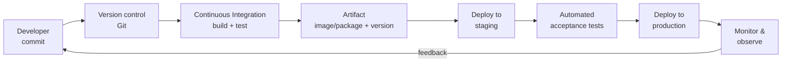

# Chapter 01 — DevOps Fundamentals & Culture

## Learning objectives

By the end of this chapter you can:

1. Explain what DevOps is, what problem it solves, and what it is *not*.
2. Describe the CALMS model and the "Three Ways" of DevOps.
3. Name and interpret the four DORA metrics.
4. Sketch the anatomy of a deployment pipeline and map tools onto its stages.
5. Recognize the common anti-patterns ("DevOps team" silo, hero culture, manual gates everywhere).

---

## 1. The problem DevOps solves

Before DevOps, the typical software organization looked like this:

- **Developers** were rewarded for *shipping features* — change.
- **Operations** were rewarded for *stability* — no change.

Two teams, opposing incentives, a "wall of confusion" between them. Code was thrown
over the wall in big, risky releases. Releases happened quarterly, took a weekend,
and frequently failed. When they failed, dev blamed ops ("worked on my machine")
and ops blamed dev ("your code broke prod").

**DevOps is the practice of removing that wall**: shared ownership of the whole
lifecycle — build, test, release, operate — supported by automation so that change
becomes small, frequent, and low-risk.

> **Key inversion:** classic thinking says "change is risky, so do it rarely."
> DevOps evidence says "doing it rarely is *why* it's risky." Small frequent changes
> are easier to test, easier to review, and trivial to roll back.

### What DevOps is NOT

- **Not a job title alone.** A "DevOps engineer" who becomes a new silo between dev
  and ops recreates the original problem with an extra hop.
- **Not just tools.** Installing Jenkins doesn't make you DevOps any more than
  buying a piano makes you a pianist. Tools enable practices; culture sustains them.
- **Not "developers do all the ops now."** It's shared responsibility with
  platform/ops expertise still very much needed.

---

## 2. CALMS — the five pillars

| Pillar | Meaning | Example |
|--------|---------|---------|
| **C**ulture | Shared responsibility, blameless learning | Blameless post-mortems after incidents |
| **A**utomation | Machines do repeatable work | CI pipelines, IaC, automated tests |
| **L**ean | Small batches, limit work-in-progress, eliminate waste | Feature flags instead of long-lived branches |
| **M**easurement | Decisions from data, not gut feel | DORA metrics, SLOs, dashboards |
| **S**haring | Knowledge flows freely | Runbooks, internal demos, shared on-call |

Use CALMS as a diagnostic: if a company has amazing automation but punishes people
for incidents (no Culture), DevOps will fail there anyway — people will hide
problems instead of fixing them.

---

## 3. The Three Ways (from *The Phoenix Project* / *The DevOps Handbook*)

1. **Flow** — optimize the whole path from commit to production, not one team's
   silo. Make work visible, reduce batch size, remove handoffs.
2. **Feedback** — shorten and amplify feedback loops. A failing test 3 minutes
   after commit is worth 100× the same failure found in production 3 weeks later.
3. **Continual learning & experimentation** — allocate time to improve the system
   of work itself; treat failures as learning material.

---

## 4. DORA metrics — how you measure DevOps performance

DORA (DevOps Research and Assessment, now part of Google) studied thousands of
organizations and found four metrics that separate elite performers from the rest:

| Metric | Question it answers | Elite performance |
|--------|--------------------|-------------------|
| **Deployment frequency** | How often do you ship to production? | On demand (multiple/day) |
| **Lead time for changes** | Commit → running in production takes how long? | < 1 day |
| **Change failure rate** | What % of deployments cause a failure? | < 15% |
| **Time to restore service (MTTR)** | Incident → recovery takes how long? | < 1 hour |

Two are **speed** metrics (frequency, lead time), two are **stability** metrics
(failure rate, MTTR). The landmark finding: **speed and stability are not a
trade-off** — elite teams are better at *both*, because the same practices
(small changes, automation, fast feedback) improve both.

> Memorize these four. They come up in interviews constantly, and they're the
> right lens for evaluating any process change: "does this improve a DORA metric?"

---

## 5. The deployment pipeline — your mental map for the whole course

Everything in this course hangs off this picture:

Mapping tools you'll learn onto the stages:

| Stage | Concepts | Tools in this course |
|-------|----------|---------------------|
| Version control | branching, PRs, trunk-based dev | Git (ch 03) |
| CI | build, unit tests, linting, security scans | GitHub Actions (ch 07), Jenkins (ch 08), GitLab CI (ch 09) |
| Artifact | immutable, versioned build outputs | Docker images (ch 05–06), registries (ch 10) |
| Deploy | environments, release strategies | Kubernetes (ch 11–12), blue-green/canary (ch 10) |
| Infrastructure | reproducible environments | Terraform (ch 13), Ansible (ch 14) |
| Operate | metrics, logs, traces, alerts | Prometheus, Grafana, Loki (ch 15) |
| Security | scanning, secrets, supply chain | DevSecOps (ch 16) |

### Continuous Integration vs. Delivery vs. Deployment

These terms are asked about in every DevOps interview. Precisely:

- **Continuous Integration (CI):** every change is merged to the mainline
  frequently (at least daily) and automatically built and tested. The output is
  confidence: "this commit is releasable or we know within minutes it isn't."
- **Continuous Delivery (CD):** every change that passes CI *can* be released at
  the push of a button. The release itself may still be a human decision.
- **Continuous Deployment:** no button. Every passing change goes to production
  automatically. (Requires excellent automated testing and monitoring.)

---

## 6. Environments

A typical progression of environments:

- **Local / dev** — the developer's machine. Fast, dirty, disposable.
- **CI** — ephemeral environment created per pipeline run.
- **Staging / pre-prod** — as close to production as affordable. Used for
  acceptance testing.
- **Production** — the real thing.

Golden rule: **environments should differ only in configuration, never in the
artifact.** You build a Docker image *once* and promote that exact image through
staging to production. Rebuilding per environment reintroduces "works in staging,
broke in prod."

---

## 7. Anti-patterns to recognize

| Anti-pattern | Why it fails |
|--------------|-------------|
| "The DevOps team" as a third silo | Adds a handoff instead of removing one. (A *platform team* building self-service tooling is the healthy version.) |
| Hero culture | One person who "knows the deploy" is a single point of failure and a burnout machine. Automate their knowledge. |
| Manual approval gates everywhere | Each gate adds queue time (kills lead time) without adding much safety. Prefer automated checks. |
| Snowflake servers | Hand-configured servers nobody can reproduce. IaC (ch 13–14) is the cure. |
| Big-bang releases | Huge blast radius, impossible rollbacks. Ship small. |
| Blame-driven post-mortems | People stop reporting problems; you lose your feedback loop. |

---

## 8. Worked example — diagnosing a team with DORA

Team A: deploys every 2 weeks, lead time ~10 days, 25% of deploys cause an
incident, restore time ~1 day.

Reading: low frequency + long lead time means big batches; big batches explain
the 25% failure rate; slow restore suggests rollback is manual/hard.

Highest-leverage fixes, in order:
1. Automate the deployment itself (repeatable, reversible) → cuts MTTR.
2. Add CI so every commit is built and tested → enables smaller batches.
3. Deploy weekly, then daily — failure rate typically *drops* as batch size shrinks.

Note the fixes are pipeline and batch-size fixes, not "hire more testers." This is
the DevOps instinct you're building.

---

## Key terms glossary

- **Artifact** — an immutable, versioned build output (JAR, Docker image, zip).
- **Pipeline** — the automated path from commit to production.
- **Idempotent** — running an operation twice has the same effect as once. Core
  property of good automation.
- **Immutable infrastructure** — servers/containers are replaced, never modified
  in place.
- **Shift left** — move testing/security earlier in the pipeline, where problems
  are cheap to fix.
- **Toil** — manual, repetitive operational work that automation should eliminate.

## Further reading

- *The Phoenix Project* (Kim, Behr, Spafford) — the novel; fastest way to absorb the culture.
- *The DevOps Handbook* (Kim, Humble, Debois, Willis) — the reference.
- *Accelerate* (Forsgren, Humble, Kim) — the research behind DORA metrics.
- Google's annual *State of DevOps* report.

## Abbreviations

| Abbreviation | Stands for | In a nutshell |
|---|---|---|
| DevOps | Development + Operations | Culture/practice merging dev and ops so change ships small, frequent, and low-risk |
| CALMS | Culture, Automation, Lean, Measurement, Sharing | Five-pillar diagnostic for whether an org is actually "doing DevOps" |
| DORA | DevOps Research and Assessment | Research group (now part of Google) behind the four key delivery metrics |
| MTTR | Mean Time To Restore | Average time from incident start to service recovery |
| CI | Continuous Integration | Every change merged to mainline frequently and auto-built/tested |
| CD | Continuous Delivery / Deployment | Every passing change is releasable at a button-push (Delivery) or ships automatically (Deployment) |
| IaC | Infrastructure as Code | Infrastructure defined in versioned files instead of manual setup |
| SLO | Service Level Objective | The reliability target a team commits to (e.g. 99.9% uptime) |
| PR | Pull Request | Proposed code change submitted for review before merging |
| JAR | Java ARchive | Java's packaged, versioned build artifact format |

**Next:** [Exercises](exercises.md) → [Test](test.md) → [Chapter 02: Linux & Shell](../02-linux-and-shell/lesson.md)
